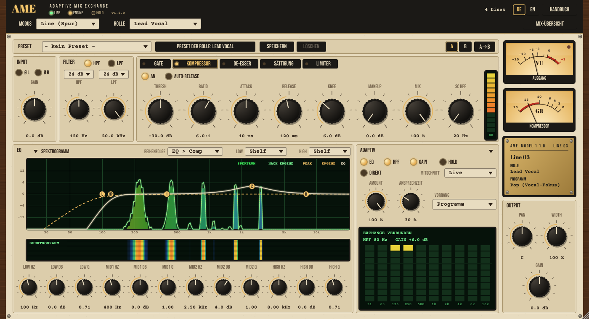
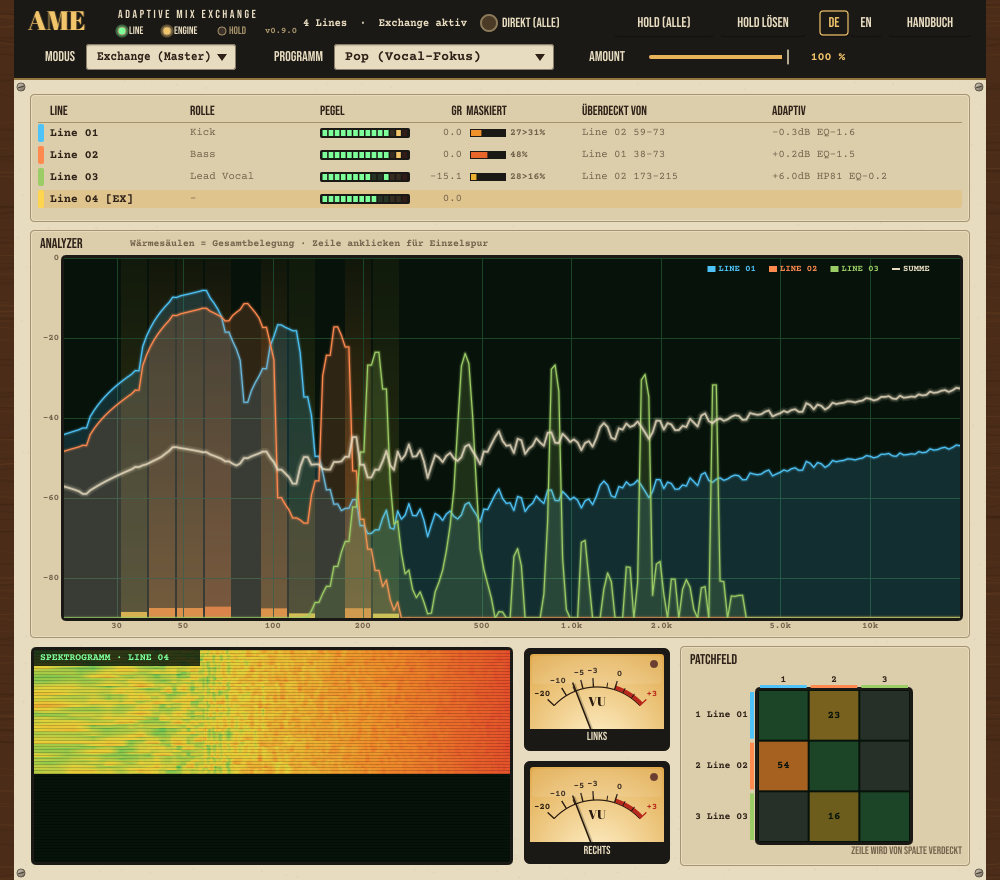

# AME – Adaptive Mix Exchange

**Handbuch · Version 0.11.0** · entwickelt von **Batze the bit builder**

*Every track finds its aim.* – Jede Spur bekommt ihren Platz.

## Überblick

AME ist ein vernetzter Channelstrip (VST3). Jede Instanz auf einer Spur heißt **Line**. Eine einzelne Instanz auf dem Master-Bus arbeitet als **Exchange** – wie das Amt einer alten Telefonvermittlung: Es hört alle Leitungen ab, erkennt, wer wem ins Wort fällt, und weist jeder Spur laufend ihren Platz im Frequenzspektrum und in der Lautstärke zu.

- **Klassischer Channelstrip** pro Spur: Input, Hoch-/Tiefpass, 4-Band-EQ, Kompressor, Pan, Stereobreite, Output.
- **Analyse**: Jede Line misst ihr Spektrum und meldet es an alle anderen Instanzen im Projekt.
- **Adaptive Engine** im Exchange: berechnet aus Programm (Genre), Rollen und Vorrang, welche Spur wo ausweicht.
- **Eigene adaptive Stufe** pro Line: 10 Oktav-Absenkungen, Hochpass und Lautstärke. Deine manuellen EQ-Einstellungen bleiben unangetastet.
- **Volle Kontrolle**: Direkt (A/B-Vergleich), Hold (Werte einfrieren), Stärke und Ansprechzeit pro Spur.

> AME hilft beim Aufräumen eines Mixes – es ersetzt nicht dein Gehör. Nutze die Eingriffe als Vorschlag, vergleiche mit **Direkt** und friere gute Ergebnisse mit **Hold** ein.

## Installation

1. `AME Adaptive Mix Exchange.vst3` nach `C:\Program Files\Common Files\VST3\` kopieren (Administratorrechte nötig).
2. Falls eine ältere `MultiTrackMix.vst3` dort liegt: löschen – beide haben dieselbe Plugin-ID.
3. Ableton Live → Einstellungen → Plug-Ins → „VST3 Plug-In System Folders" einschalten → **Neu scannen**.
4. AME erscheint unter dem Hersteller **Batze the bit builder**.

Bestehende Live-Sets mit früheren Versionen laden weiter: Parameter-IDs und Speicherformat sind unverändert.

**Andere DAWs:** AME läuft in jeder Windows-DAW mit VST3 (z. B. Cubase, Studio One, Reaper, FL Studio, Bitwig). Die Instanzen finden sich über gemeinsamen Speicher der DAW-Sitzung – auch dann, wenn die DAW Plug-ins in getrennten Prozessen betreibt (Sandbox, Bridge, z. B. Bitwig „Individually“). Getestet ist bisher Ableton Live.

## Schnellstart

1. **AME auf jede Spur** laden, die mitgemischt werden soll. Modus: **Line (Spur)**.
2. **Rolle** wählen (z. B. Kick, Bass, Lead Vocal) – oder auf **Auto-Kennung** lassen.
3. **Eine AME-Instanz auf den Master-Bus** legen und den Modus auf **Exchange (Master)** stellen.
4. Im Exchange das **Programm** wählen (z. B. Rock / Band, Pop, Electronic).
5. Wiedergabe starten. Nach wenigen Sekunden leuchtet die Lampe **ENGINE**, die Lines weichen sich gegenseitig aus.
6. Mit **Direkt (alle)** im Exchange vorher/nachher vergleichen. Gefällt das Ergebnis: **Hold (alle)**.

> Ohne Exchange laufen alle Lines „solo": Der Channelstrip funktioniert normal, es gibt aber keine adaptiven Eingriffe.

## Prinzip: Lines und Exchange

| Begriff | Bedeutung |
|---|---|
| Line | AME-Instanz auf einer Spur (Modus „Line (Spur)") |
| Exchange | AME-Instanz auf dem Master-Bus (Modus „Exchange (Master)"), steuert die Engine |
| Programm | Zielprofil / Genre-Preset des gesamten Mixes |
| Rolle | Funktion einer Spur im Arrangement (Kick, Bass, Gesang …) |
| Vorrang | Wie wichtig eine Spur gegenüber ihrem Programm-Standard ist |
| Ansprechzeit | Wie schnell die Eingriffe folgen (langsam = Balance, schnell = Ducking) |
| Direkt | A/B-Bypass der adaptiven Eingriffe |
| Hold | Aktuelle adaptive Werte festhalten |
| Patchfeld | Matrix: welche Spur welche verdeckt |

**So läuft es ab:**

- Alle Instanzen im selben Projekt finden sich automatisch (prozessweites Register in der Plugin-DLL). Es gibt nichts zu verbinden.
- Jede Line analysiert ihr Signal (FFT, 32 Bänder, Kurz- und Langzeitspektrum) und stellt es den anderen bereit.
- Das Exchange berechnet 50-mal pro Sekunde Zielwerte für jede Line und schickt sie zurück.
- Jede Line nähert sich diesen Zielen geglättet an – mit der eingestellten Ansprechzeit.

Gibt es mehrere Exchange-Instanzen, ist nur die **älteste** aktiv; die anderen zeigen „[EX–]" und einen Hinweis in der Statuszeile.

## Kopfzeile

Die Kopfzeile ist in Line und Exchange gleich aufgebaut:

- **AME-Schriftzug mit drei Lampen**:
  - **LINE** (grün) – ein Exchange ist vorhanden.
  - **ENGINE** (bernstein) – die Engine rechnet gerade (Lebenszeichen jünger als 0,5 s).
  - **HOLD** (blau) – diese Line hält ihre Werte fest.
- **Statuszeile**: Anzahl der Lines, Exchange-Status und Hinweise.
- **DE / EN**: Sprache der Oberfläche. Die Wahl gilt sofort für alle offenen AME-Fenster und wird für künftige Sitzungen gespeichert. Beim allerersten Start folgt AME der Systemsprache.
- **HANDBUCH**: öffnet dieses Handbuch. Kapitel links anklicken, **SCHLIESSEN** kehrt zurück.
- **Modus**: Line (Spur) oder Exchange (Master).
- **Line**: Rollenauswahl, bei Auto-Kennung die erkannte Rolle, Schalter **Mix-Übersicht**.
- **Exchange**: Programm, globaler Amount, Direkt (alle), Hold (alle), Hold lösen.

> Parameter-Namen in der DAW (Automation) sind immer englisch – unabhängig von der gewählten Sprache.

## Die Line (Spur-Ansicht)

### Input
**Gain** (±24 dB) – Eingangspegel vor allen Stufen.

### Filter
**HPF** (20 Hz–1 kHz) und **LPF** (1–20 kHz), je 24 dB/Oktave. Die Lampen **HPF** / **LPF** im Titel schalten die Filter ein.

### Kompressor
Soft-Knee, stereo-gekoppelt. **Thresh**, **Ratio** (1:1–20:1), **Attack** (0,1–100 ms), **Release** (10–1000 ms), **Makeup** (0–24 dB). Lampe **An** schaltet ihn ein. Die Gain Reduction zeigt das rechte VU-Meter.

### Output
**Pan**, **Width** (0–200 %, 100 % = unverändert, 0 % = Mono) und **Gain** (±24 dB).

### EQ mit Analyzer
Vier Bänder: Low Shelf, Mid 1, Mid 2 (Peak mit Q) und High Shelf (±18 dB).

Die Grafik zeigt:

- **Spektrum** der Spur als Regenbogenfläche (vor der Engine),
- **Nach Engine** als grüne Leuchtlinie,
- **Peak** gepunktet (fällt mit 12 dB/s),
- **EQ**-Kurve (creme) mit ziehbaren Punkten L, 1, 2, H, HP, LP,
- **Engine**-Kurve gestrichelt (bernstein).

Bedienung: Punkt **ziehen** = Frequenz/Gain, **Mausrad** = Q, **Doppelklick** = 0 dB. Darunter läuft das **Spektrogramm**.

### Adaptiv
- **Amount** – Stärke der Engine-Eingriffe für diese Line (0–100 %).
- **Ansprechzeit** – 0 % = langsam (Eingriff ca. 1,5 s, Rücknahme ca. 3 s; für die Langzeit-Balance), 100 % = schnell (ca. 20 ms / 150 ms; Ducking, z. B. Bass weicht der Kick aus). Standard 30 %.
- **Vorrang** – Programm (Standard der Rolle) oder Sehr hoch / Hoch / Niedrig / Sehr niedrig. Höherer Vorrang = andere Spuren weichen dieser Spur aus.
- Lampen **EQ / HPF / Gain** – welche Eingriffsarten erlaubt sind.
- **Direkt** – Eingriffe dieser Line aus (A/B, mit 30 ms Überblendung).
- **Hold** – aktuelle Werte festhalten.

Die LED-Anzeige rechts zeigt die aktuelle Absenkung je Oktavband (31 Hz–16 kHz, bis −9 dB Skala), dazu adaptiven Hochpass und Lautstärkekorrektur sowie den Status (EXCHANGE VERBUNDEN, NO EXCHANGE, DIREKT, HOLD).

### VU-Meter und Typenschild
- **Ausgang**: VU-Ballistik (0 VU = −18 dBFS RMS), Peak-Lampe ab −1 dBFS.
- **Kompressor**: Gain Reduction 0 bis −20 dB.
- **Typenschild**: Version, Line-Nummer, Spurname (aus der DAW), Rolle und aktives Programm.

## Das Exchange (Master)

Das Exchange schleift das Audiosignal unverändert durch und zeigt die **Mix-Übersicht**. Auf Lines lässt sie sich über den Schalter **Mix-Übersicht** ebenfalls einblenden.

- **Programm** – Genre-Profil für den ganzen Mix (siehe Kapitel Programme).
- **Amount** (global) – skaliert die Eingriffe aller Lines.
- **Direkt (alle)** – A/B-Vergleich für den gesamten Mix.
- **Hold (alle) / Hold lösen** – schaltet Hold auf allen Lines.

### Mix-Übersicht
Die Tabelle listet alle Lines:

| Spalte | Inhalt |
|---|---|
| Line | Name, Spurfarbe; [EX] = aktives Exchange, [EX–] = inaktives |
| Rolle | gewählte Rolle; „(A)" = automatisch erkannt |
| Pegel | LED-Kette des Pegels |
| GR | Gain Reduction des Kompressors |
| Maskiert | Maskierungsgrad vorher > nachher (in %) |
| Überdeckt von | Hauptverursacher und Frequenzbereich |
| Adaptiv | aktuelle Eingriffe: Gain, HP (Hochpass), EQ (stärkste Absenkung), [DIR] / [HOLD] |

**Zeile anklicken** wählt eine Spur aus: Der Analyzer zeigt dann ihre Überdeckung als Wärmesäulen (gelb → rot), ihr Spektrum vor der Engine gestrichelt, den Peak gepunktet und ihr Spektrogramm.

### Analyzer, Patchfeld, VU
- **Analyzer**: alle Spuren als farbige Flächen, die **Summe** als Creme-Linie; ohne Auswahl zeigen die Wärmesäulen die Gesamtbelegung je Frequenz.
- **Patchfeld**: Matrix aller Lines – Zeile wird von Spalte verdeckt. Je heller, desto stärker. Klick wählt die Spur.
- **VU Links/Rechts**: Summenpegel.

## Programme

Ein Programm legt für jede Rolle Vorrang je Frequenzregion (Sub / Low / Mid / High), Ziel-Lautheit und maximalen Hochpass fest – dazu die Grenzen der Engine:

| Programm | max. Absenkung | max. Lautstärke-Korrektur | Charakter |
|---|---|---|---|
| Rock / Band | 6 dB | ±6 dB | Gesang und Snare vorne, Gitarren im Mittenband |
| Pop (Vocal-Fokus) | 6 dB | ±6 dB | Lead Vocal klar dominant |
| Electronic | 8 dB | ±6 dB | Kick und Bass tragen, kräftiges Ducking möglich |
| Hip-Hop | 8 dB | ±6 dB | Kick/808 und Stimme im Zentrum |
| Akustik / Singer-Songwriter | 4 dB | ±4 dB | behutsam, natürliche Balance |
| Metal | 7 dB | ±6 dB | Gitarrenwand, Kick-Durchsetzung |

## Rollen und Auto-Kennung

Verfügbare Rollen: Kick, Snare, Drums/Overheads, Percussion, Bass, Lead Vocal, Backing Vocals, E-Gitarre, Akustikgitarre, Keys/Piano, Synth Lead, Pad, Streicher, Bläser, FX, Sonstiges.

Bei **Auto-Kennung** erkennt AME die Rolle selbst:

1. **Spurname** (sofort, 100 %): deutsche und englische Namen sowie Abkürzungen wie BD, SD, OH, Vox, BGV, Gtr, Ac Gtr, 808, Rhodes …
2. **Klang** (nach ca. 3 s Signal): Schwerpunkt, Tonalität, Grundton, Transienten, Vibrato, Crest-Faktor, Stereobreite. Anzeige „→ Rolle (xx %)".
3. **Hysterese**: Ein Wechsel erfolgt nur bei deutlichem Vorsprung (+15 %); unter 25 % Sicherheit gilt „Sonstiges".

Eine manuell gewählte Rolle hat immer Vorrang.

## So arbeitet die Engine

1. **Konflikte finden**: In jedem der 32 Bänder prüft die Engine, wo zwei Spuren gleichzeitig Energie haben (bis 18 dB Pegelabstand, voll ab 6 dB).
2. **Vorrang vergleichen**: Die Spur mit niedrigerem Vorrang weicht aus. Sind beide gleichrangig, geben beide ein wenig nach.
3. **Ducking**: Mit schneller Ansprechzeit folgt das Ausweichen dem Kurzzeitpegel der wichtigeren Spur – die Absenkung kommt nur, wenn diese gerade spielt.
4. **Hochpass**: Unterhalb des Nutzsignals einer Spur (30 dB unter ihrem Maximum) setzt die Engine einen Hochpass, höchstens bis zum Rollen-Maximum.
5. **Lautstärke**: Die Spuren werden auf die Rollen-Verhältnisse des Programms gebracht – die **Summenleistung bleibt dabei konstant**, der Mix wird also nicht einfach lauter oder leiser.
6. **Ausgabe**: Die Absenkungen werden auf 10 Oktavbänder (31 Hz–16 kHz) abgebildet; die Line nähert sich ihnen mit ihrer Ansprechzeit (HPF und Gain mit ca. 2 s).

Die Engine **senkt nur ab** – sie hebt keine Frequenzen an. Dein manueller EQ wird nie verändert; die adaptive Stufe sitzt hinter Kompressor und EQ, vor Pan/Width.

> Daten anderer Spuren sind mindestens einen Audio-Block alt (die DAW rechnet Spuren parallel). Deshalb arbeitet AME geglättet und nicht samplegenau.

## Direkt und Hold

- **Direkt** (Line) bzw. **Direkt (alle)** (Exchange) schaltet nur die adaptiven Eingriffe aus. Der manuelle Channelstrip läuft weiter. Ideal für A/B-Vergleiche – automatisierbar.
- **Hold** friert die aktuellen adaptiven Werte ein. Sie werden im Live-Set gespeichert und gelten auch ohne Exchange oder bei anderem Programm.
- **Hold (alle) / Hold lösen** im Exchange schaltet Hold auf allen Lines.

Typischer Ablauf: Programm wählen → Song einige Male durchlaufen lassen → mit Direkt vergleichen → Hold (alle) → Exchange bei Bedarf entfernen.

## Tipps für den Workflow

- **Rollen setzen** lohnt sich: Die Auto-Kennung ist gut, eine bewusste Wahl ist besser.
- **Vorrang** nur dort ändern, wo das Programm nicht passt (z. B. Gitarrensolo: Vorrang Sehr hoch).
- **Langsame Ansprechzeit** für Flächen, Gitarren, Keys; **schnell** für Bass gegen Kick oder Pads gegen Gesang.
- **Amount** pro Spur zurücknehmen, wenn eine Spur zu stark bearbeitet wird; global im Exchange für den ganzen Mix.
- Im **Patchfeld** zuerst die hellsten Felder ansehen – dort liegen die größten Konflikte.
- Auf Bussen (z. B. Drum-Bus) kann AME als eine Line arbeiten statt auf jeder Einzelspur.

## Fehlersuche

| Symptom | Ursache / Lösung |
|---|---|
| „No Exchange – Line läuft solo" | Keine AME-Instanz im Modus Exchange auf dem Master-Bus. |
| Lampe ENGINE aus | Exchange ist geladen, wird aber nicht verarbeitet (Gerät deaktiviert, Master-Spur eingefroren). |
| „n Exchanges – nur das älteste ist aktiv" | Mehrere Exchange-Instanzen: überzählige auf Line stellen oder entfernen. |
| Keine Eingriffe trotz Engine | Direkt aktiv? Amount auf 0? Lampen EQ/HPF/Gain aus? Hold aktiv? |
| Spur fehlt in der Übersicht | Tooltip der Statuszeile zeigt die Verbindung: „nur innerhalb dieses Prozesses“ = gemeinsamer Speicher nicht verfügbar → Plug-ins im selben Prozess betreiben. Läuft die Instanz in einem Hilfsprozess, den AME nicht der DAW zuordnet, in allen Prozessen dieselbe Umgebungsvariable `AME_HUB_SESSION` setzen. |
| Spur bleibt nach Absturz eines Plug-in-Prozesses stehen | Wird nach spätestens einer Sekunde automatisch entfernt. |
| Auto-Kennung falsch | Spurnamen eindeutig benennen oder Rolle manuell setzen. |
| Spurnamen „Line 01" … | Die DAW übermittelt keinen Namen – Rolle manuell setzen. |

## Über AME

**AME – Adaptive Mix Exchange**, Version 0.11.0

Entwickelt von **Batze the bit builder**.

- Framework: JUCE 8 (C++20), Format VST3, Windows (getestet mit Ableton Live).
- Schriften: Abril Fatface, Bebas Neue, Courier Prime – SIL Open Font License.
- **Lizenz: GNU Affero General Public License v3 (AGPLv3)** – freie, offene Software. Du darfst AME nutzen, verändern und weitergeben, auch kommerziell. Wer eine veränderte Fassung weitergibt, muss deren Quellcode ebenfalls unter AGPLv3 offenlegen. AME wird ohne jede Gewährleistung bereitgestellt.
- Quellcode: [github.com/BatzeBitBuilder/AME-Adaptive-Mix-Exchange](https://github.com/BatzeBitBuilder/AME-Adaptive-Mix-Exchange)
- Fremdkomponenten: JUCE (AGPLv3), VST 3 SDK (MIT, Steinberg), Schriften (OFL) – Details in THIRD_PARTY_NOTICES.md. VST ist eine Marke der Steinberg Media Technologies GmbH.
- Name und Bildsprache: Telefonvermittlung aus der Röhrenzeit – jede Spur ist ein Anschluss, das Exchange ist das Amt.

*Every track finds its aim.*
