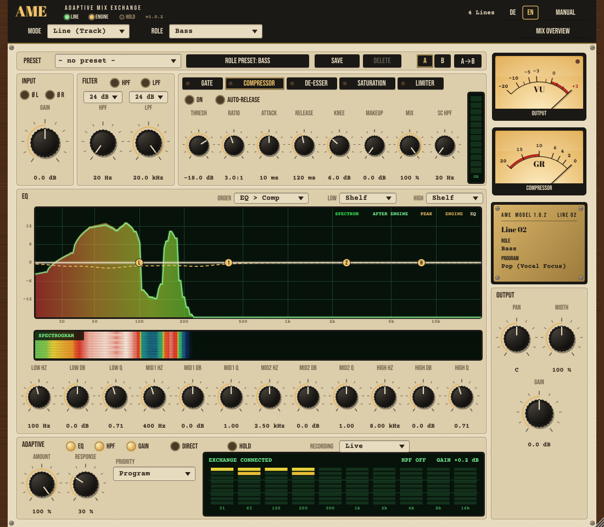
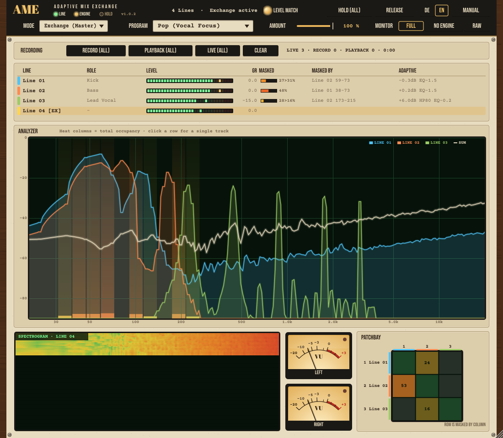

# AME – Adaptive Mix Exchange

**Operating Manual · Version 1.0.2** · built by **Batze the bit builder**

*Every track finds its aim.*

## Overview

AME is a networked channel strip (VST3). Every instance on a track is called a **Line**. A single instance on the master bus works as the **Exchange** – like the switchboard of an old telephone exchange: it listens to all lines, notices who is talking over whom, and continuously assigns every track its place in the frequency spectrum and in the level balance.

- **Classic channel strip** per track: input, high/low-pass, 4-band EQ, compressor, pan, stereo width, output.
- **Analysis**: every Line measures its spectrum and shares it with all other instances in the project.
- **Adaptive engine** in the Exchange: works out from program (genre), roles and priority which track should make room where.
- **Dedicated adaptive stage** per Line: 10 octave cuts, high-pass and level. Your manual EQ settings are never touched.
- **Full control**: Direct (A/B comparison), Hold (freeze values), amount and response per track.
- **Export = monitor**: the engine runs on the audio clock, and the **recording** captures the processing along the song and plays it back exactly – even when exporting single tracks.

> AME helps you clean up a mix – it does not replace your ears. Treat its moves as suggestions, compare with **Direct** and freeze good results with **Hold**.

## Installation

1. Copy `AME Adaptive Mix Exchange.vst3` to `C:\Program Files\Common Files\VST3\` (administrator rights required).
2. Let your DAW rescan its plug-ins (make sure the system VST3 folder is included in its plug-in settings).
3. AME appears under the vendor **Batze the bit builder**.

| DAW | Where to rescan |
|---|---|
| Ableton Live | Settings → Plug-Ins → enable "VST3 Plug-In System Folders" → Rescan |
| Cubase / Nuendo | Studio → VST Plug-in Manager → Rescan |
| Studio One | Options → Locations → VST Plug-ins → Reset Blocklist, then restart |
| Reaper | Options → Preferences → Plug-ins → VST → Re-scan |
| Bitwig Studio | Settings → Locations → Plug-ins (rescans automatically) |
| FL Studio | Options → Manage plugins → Find installed plugins |

**Compatibility:** AME runs in all common VST3 hosts on Windows 64-bit. The instances find each other through shared memory of the DAW session – even when the DAW runs plug-ins in separate processes (sandbox, bridge, e.g. Bitwig "Individually"). Tested with Ableton Live.

## Quick start

1. **Load AME on every track** that should take part. Mode: **Line (Track)**.
2. Choose a **Role** (e.g. Kick, Bass, Lead Vocal) – or leave it on **Auto-ID**.
3. **Put one AME instance on the master bus** and set its mode to **Exchange (Master)**.
4. In the Exchange, choose a **Program** (e.g. Rock / Band, Pop, Electronic).
5. Start playback. After a few seconds the **ENGINE** lamp lights up and the Lines start making room for each other.
6. Compare with the **Monitor** in the Exchange: **Full** / **No Engine** / **Raw**.
7. Happy with the result? In the Exchange press **Record (all)**, play the whole song once, then **Playback (all)**. Exports now sound exactly like the monitor (see chapter "Export and recording").

> Without an Exchange every Line runs "solo": the channel strip works normally, but there is no adaptive processing.

## Concept: Lines and Exchange

| Term | Meaning |
|---|---|
| Line | AME instance on a track (mode "Line (Track)") |
| Exchange | AME instance on the master bus (mode "Exchange (Master)"), runs the engine |
| Program | target profile / genre preset for the whole mix |
| Role | function of a track in the arrangement (kick, bass, vocal …) |
| Priority | how important a track is compared with its program default |
| Response | how fast the processing follows (slow = balance, fast = ducking) |
| Direct | A/B bypass of the adaptive processing |
| Hold | freeze the current adaptive values |
| Patchbay | matrix showing which track masks which |

**How it works:**

- All instances in the same project find each other automatically (shared memory of the DAW session, even across plug-in processes). Nothing needs to be connected.
- Every Line analyses its signal (FFT, 32 bands, short- and long-term spectrum) and shares it with the others.
- The Exchange computes target values for each Line every 20 ms of audio (50 times per second) and sends them back.
- Each Line moves smoothly towards these targets – at the response speed you set.

If there are several Exchange instances, only the **oldest** one is active; the others show "[EX–]" and a note in the status line.

## Header

The header looks the same in Line and Exchange mode:

- **AME logo with three lamps**:
  - **LINE** (green) – an Exchange is present.
  - **ENGINE** (amber) – the engine is running (heartbeat younger than 0.5 s).
  - **HOLD** (blue) – this Line is holding its values.
- **Status line**: number of Lines, Exchange status and hints.
- **DE / EN**: interface language. The choice applies immediately to all open AME windows and is remembered for future sessions. On the very first start AME follows the system language.
- **MANUAL**: opens this manual. Click a chapter on the left; **CLOSE** returns to the plug-in.
- **Mode**: Line (Track) or Exchange (Master).
- **Line**: role selector, the detected role when Auto-ID is active, **Mix Overview** button.
- **Exchange**: program, global amount, monitor (Full / No Engine / Raw), level match, Hold (all), Release.

> Parameter names in the DAW (automation) are always English – regardless of the selected language.

## The Line (track view)

Signal path: **Input → Phase → Filter → Gate → EQ ⇄ Compressor → De-esser → Saturation → [analysis] → Adaptive → Pan/Width → Output → Limiter**

### Presets and A/B
The bar at the top:

- **Preset**: factory presets by role (starting points for filter, EQ, gate, compressor, de-esser, saturation) and **user presets**. Factory presets leave input, phase, pan, width, output and limiter unchanged.
- **Role preset**: loads the factory preset of the selected or auto-detected role.
- **Save**: store the current settings as a user preset (the same name overwrites). User presets live in `%APPDATA%\AME\Presets` and are available in every project.
- **Delete**: delete the loaded user preset.
- **A / B**: compare two settings. On the first switch, B starts as a copy of A. **A→B** copies the active setting to the other slot. Both are saved with the project.

Presets set parameters just like turning the knobs – the DAW can undo them.

### Input
**Gain** (±24 dB). **Ø L / Ø R** invert the phase (polarity) of the left or right channel – e.g. for snare bottom or kick out.

### Filter
**HPF** (20 Hz–1 kHz) and **LPF** (1–20 kHz); the lamps in the title switch them on. Below them the **slope**: 12, 24 or 48 dB/octave.

### Module rack
Five modules on tabs; the lamp in a tab shows whether the module is on. On the right, the LED chain shows the current gain reduction of the visible module (0–24 dB). The last tab chosen is remembered in the project.

**Gate / expander** – **Gate** closes by **Range** below the threshold (3 dB hysteresis against chattering), **Expander 1:2 / 1:4** lowers quiet parts by the ratio (at most by Range). **Attack**, **Hold**, **Release**; **SC HPF** filters only the detector signal (e.g. so bass spill does not open the gate).

**Compressor** – **Thresh**, **Ratio** (1:1–20:1), **Attack**, **Release**, **Knee** (0 = hard, up to 18 dB soft), **Makeup**, **Mix** (parallel compression: 0 % = unprocessed), **SC HPF** (lows trigger less compression). **Auto-Release**: fast recovery after short peaks, slow recovery during sustained compression. The VU meter on the right also shows the gain reduction.

**De-esser** – **Freq** (2.5–12 kHz), **Thresh**, **Range** (maximum reduction). **Split**: only the band above the frequency is reduced (crossover), **Wide**: the whole signal. **Listen** outputs only the sibilance band – to set the frequency.

**Saturation / exciter** – **Tube** (soft, even harmonics), **Tape** (soft, symmetric), **Transistor** (harder). **Drive** 0–24 dB with automatic level compensation: quiet signals stay unchanged, loud ones get denser. **Mix** blends in the original. **Exciter** adds harmonics generated only from the high band (above **Exc Freq**) – for presence and sheen.

**Limiter** – sits at the very end after the output gain. **Limiter**: zero-latency peak limiter with **Release**. **Soft Clip**: soft saturation towards the **Ceiling**. **Hard Clip**: hard cut. No signal exceeds the ceiling.

### EQ with analyser
Four bands (±18 dB): **Low** and **High** either **Shelf** or **Bell** (selection in the title), Mid 1 and Mid 2 as bells. All bands with **Q** (for shelves = steepness of the transition). **Order**: EQ before or after the compressor.

The display shows:

- **Spectrum** of the track as a rainbow area (before the engine),
- **After engine** as a green glowing line,
- **Peak** dotted (falls at 12 dB/s),
- the **EQ** curve (cream, incl. filters) with draggable points L, 1, 2, H, HP, LP,
- the **Engine** curve dashed (amber).

Handling: **drag** a point = frequency/gain, **mouse wheel** = Q, **double-click** = 0 dB. The **spectrogram** runs underneath.

### Output
In the right-hand column: **Pan**, **Width** (0–200 %, 100 % = unchanged, 0 % = mono) and **Gain** (±24 dB).

### Adaptive
- **Amount** – strength of the engine's processing for this Line (0–100 %).
- **Response** – 0 % = slow (cut in about 1.5 s, release in about 3 s; for long-term balance), 100 % = fast (about 20 ms / 150 ms; ducking, e.g. bass making room for the kick). Default 30 %.
- **Priority** – Program (role default) or Very high / High / Low / Very low. Higher priority = other tracks make room for this one.
- **EQ / HPF / Gain** lamps – which kinds of processing are allowed.
- **Direct** – processing of this Line off (A/B, with a 30 ms crossfade).
- **Hold** – freeze the current values.
- **Recording** – **Live** (engine adapts continuously), **Record** (capture the applied values along the song position) or **Playback** (replay the capture exactly). See chapter "Export and recording".

The LED display on the right shows the current cut per octave band (31 Hz–16 kHz, scale down to −9 dB), the adaptive high-pass and level correction, and the status (EXCHANGE CONNECTED, NO EXCHANGE, DIRECT, HOLD, RECORDING, PLAYBACK RECORDING, EXPORT WITHOUT EXCHANGE).

### VU meters and name plate
- **Output**: VU ballistics (0 VU = −18 dBFS RMS), peak lamp from −1 dBFS.
- **Compressor**: gain reduction 0 to −20 dB.
- **Name plate**: version, Line number, track name (from the DAW), role and active program.

### Window size
Drag the bottom-right corner to scale the window freely from 50 to 200 %. The last size chosen applies to all AME windows.

## The Exchange (master)

The Exchange passes audio through unchanged and shows the **Mix Overview**. On Lines you can show it too with the **Mix Overview** button.

- **Program** – genre profile for the whole mix (see chapter Programs).
- **Amount** (global) – scales the processing of all Lines.
- **Monitor** – comparison for the whole mix:
  - **Full** – everything active (channel strips + engine).
  - **No Engine** – manual channel strips only, engine processing off (formerly "Direct (all)").
  - **Raw** – all Lines output their unprocessed input, as if no plug-ins were loaded. Switching uses a 30 ms crossfade and analysis keeps running – switching back is instant.
  - The monitor is automatable (parameter "Monitor", e.g. via MIDI map on a button) and is **not** saved with the project: it always loads as Full.
- **Level match** – in Raw, compensates the loudness difference to the processed mix at the Exchange output (±12 dB, value shown in the status line), so the louder version does not simply sound "better". Based on the power before and after each Line (approximation, tracks treated as uncorrelated).
- **Deactivating the Exchange** (device off or bypassed in the DAW) acts like **No Engine**: the engine stops and the Lines fade out their processing. The status line and the Lines show "Exchange deactivated".
- **Hold (all) / Release** – switches Hold on all Lines.
- **Recording bar** (above the table): **Record (all)**, **Playback (all)**, **Live (all)** and **Clear** (with confirmation) for all Lines. Next to it: how many Lines are live, recording or playing back, the length of the longest recording, "RECORDING" while capturing and a warning if Lines were exported without an Exchange.

### Mix Overview
The table lists all Lines:

| Column | Content |
|---|---|
| Line | name, track colour; [EX] = active Exchange, [EX–] = inactive |
| Role | selected role; "(A)" = detected automatically |
| Level | LED level chain |
| GR | compressor gain reduction |
| Masked | masking before > after (in %) |
| Masked by | main culprit and frequency range |
| Adaptive | current processing: gain, HP (high-pass), EQ (deepest cut), [DIR] / [HOLD] |

**Click a row** to select a track: the analyser then shows its masking as heat columns (yellow → red), its spectrum before the engine dashed, its peak dotted and its spectrogram.

### Analyser, patchbay, VU
- **Analyser**: all tracks as coloured areas, the **sum** as a cream line; with no selection the heat columns show the total occupancy per frequency.
- **Patchbay**: matrix of all Lines – the row is masked by the column. Brighter = stronger. Click to select a track.
- **VU Left/Right**: master level.

## Programs

A program defines, for every role, the priority per frequency region (sub / low / mid / high), target loudness and maximum high-pass – plus the limits of the engine:

| Program | max. cut | max. level correction | Character |
|---|---|---|---|
| Rock / Band | 6 dB | ±6 dB | vocal and snare up front, guitars in the mids |
| Pop (Vocal Focus) | 6 dB | ±6 dB | lead vocal clearly dominant |
| Electronic | 8 dB | ±6 dB | kick and bass carry the track, strong ducking possible |
| Hip-Hop | 8 dB | ±6 dB | kick/808 and voice in the centre |
| Acoustic / Singer-Songwriter | 4 dB | ±4 dB | gentle, natural balance |
| Metal | 7 dB | ±6 dB | wall of guitars, kick cuts through |

## Roles and Auto-ID

Available roles: Kick, Snare, Drums/Overheads, Percussion, Bass, Lead Vocal, Backing Vocals, Electric Guitar, Acoustic Guitar, Keys/Piano, Synth Lead, Pad, Strings, Brass, FX, Other.

With **Auto-ID** AME detects the role by itself:

1. **Track name** (instant, 100 %): German and English names plus abbreviations such as BD, SD, OH, Vox, BGV, Gtr, Ac Gtr, 808, Rhodes …
2. **Sound** (after about 3 s of signal): centroid, tonality, fundamental, transients, vibrato, crest factor, stereo width. Shown as "→ Role (xx %)".
3. **Hysteresis**: the role only changes with a clear lead (+15 %); below 25 % confidence it falls back to "Other".

A manually selected role always wins.

## How the engine works

1. **Find conflicts**: in each of the 32 bands the engine checks where two tracks carry energy at the same time (up to 18 dB level difference, fully from 6 dB).
2. **Compare priority**: the track with the lower priority makes room. If both are equal, both give a little.
3. **Ducking**: with a fast response the cut follows the short-term level of the more important track – it only happens while that track is actually playing.
4. **High-pass**: below a track's useful signal (30 dB under its maximum) the engine sets a high-pass, at most up to the role's limit.
5. **Level**: tracks are brought to the program's role ratios – **the total power stays constant**, so the mix does not simply get louder or quieter.
6. **Output**: the cuts are mapped to 10 octave bands (31 Hz–16 kHz); each Line follows them with its response (HPF and gain with about 2 s).

The engine runs on the **audio clock**: one step per 20 ms of audio, triggered by the Exchange. Whether the DAW plays in real time or exports faster or slower makes no difference to its behaviour.

The engine **only cuts** – it never boosts frequencies. Your manual EQ is never changed; the adaptive stage sits after compressor and EQ, before pan/width.

> Data from other tracks is at least one audio block old (the DAW processes tracks in parallel). That is why AME works smoothed rather than sample-accurate.

## Direct and Hold

- **Direct** (Line) or the **No Engine** monitor (Exchange) switches off the adaptive processing only. The manual channel strip keeps working. Ideal for A/B comparisons – automatable. **Raw** (Exchange) also bypasses all channel strips.
- **Hold** freezes the current adaptive values. They are saved with the project and stay in effect even without an Exchange or with a different program.
- **Hold (all) / Release** in the Exchange switches Hold on all Lines.

Hold freezes **one** state for the whole song (the one at the moment you press Hold) – the mix is no longer adaptive. To keep the song adaptive and still reproducible, use the **recording**.

## Export and recording

Goal: **the export sounds like the monitor in the DAW.** AME takes care of this on two levels.

**1. Engine on the audio clock.** The engine computes one step per 20 ms of audio – during playback just as during an offline export, however fast the DAW renders. An export in Live mode therefore largely matches the monitor. Small differences remain possible: the processing depends on what played before (start position, previous passes), and the DAW processes tracks in parallel.

**2. Recording – exact, also for single tracks.** Every Line captures the values it actually applies (10 cuts, high-pass, level) along the DAW's **song position**, 50 values per second. In playback it applies exactly these values at exactly that position – without engine, without Exchange, independent of render speed and pre-roll. The song stays adaptive: chorus and verse get their own processing.

How to:
1. Set program, roles, priority and amount, play the song a few times and compare with the monitor until you like it.
2. Monitor on **Full**. In the Exchange press **Record (all)**.
3. Play the song **once all the way through** (from the start, or only the sections you want to re-record – recording only overwrites the parts that are played). The Lines show "RECORDING" and the length.
4. **Playback (all)**. From now on every playback and every export sounds identical.
5. Export – full mix or single tracks (stems), real time or offline. The Exchange is no longer needed for this.

Good to know:
- The recording is saved **with the project**, compressed (per Line, up to 30 minutes of song length).
- In playback, changes to program, amount, priority or response have **no** effect – record again or switch to **Live**. The manual channel strip and **Direct** keep working.
- Parts not recorded: gaps up to 10 s are bridged (nearest recorded value), beyond that there is no processing.
- After changing the arrangement (moved sections, tempo changes) re-record the affected parts.
- Selectable per Line in the ADAPTIVE section (**Recording**), for all Lines in the Exchange. **Live (all)** keeps the recording, **Clear** removes it.
- Recording playback takes precedence over Hold.

**Exporting without a recording – what to watch:**
- The Exchange must **run along** during the export. If the DAW exports single tracks without processing the master bus, the engine has no data – the Lines then run without adaptive processing. AME detects this (the DAW's offline flag or audio running faster than real time) and afterwards shows **EXPORT WITHOUT EXCHANGE – NO ADAPTIVE** on the Line and "× EXPORT WITHOUT EXCHANGE" in the Exchange (for 5 minutes). Remedy: use the recording.
- Without a recording the result depends on what played before: best export from the start of the song, after a few passes.

Typical workflow: choose a program → let the song play a few times → compare with the monitor → Record (all) → play the song once → Playback (all) → export. Alternatively, for one fixed state: Hold (all).

## Workflow tips

- **Setting roles** pays off: Auto-ID is good, a deliberate choice is better.
- Load the **role preset** as a starting point, then adapt the gate and compressor thresholds to the track's level.
- Use **A/B** to compare two approaches directly (e.g. with and without saturation); save good settings as a **user preset**.
- Change **Priority** only where the program does not fit (e.g. guitar solo: Very high).
- **Slow response** for pads, guitars, keys; **fast** for bass against kick or pads against vocals.
- Lower **Amount** per track if a track is processed too much; globally in the Exchange for the whole mix.
- In the **patchbay**, look at the brightest cells first – that is where the biggest conflicts are.
- On buses (e.g. a drum bus) AME can work as one Line instead of on every single track.

## Troubleshooting

| Symptom | Cause / solution |
|---|---|
| "No Exchange – line runs solo" | No AME instance in Exchange mode on the master bus. |
| ENGINE lamp off | The Exchange is loaded but not being processed (device deactivated, master track frozen). |
| "n exchanges – only the oldest is active" | Several Exchange instances: switch the extra ones to Line or remove them. |
| No processing although the engine runs | Direct on? Amount at 0? EQ/HPF/Gain lamps off? Hold on? |
| Track missing from the overview | The status line tooltip shows the link: "this process only" = shared memory not available → run plug-ins in the same process. If the instance runs in a helper process AME does not attribute to the DAW, set the same environment variable `AME_HUB_SESSION` for all processes. |
| Track stays listed after a plug-in process crashed | Removed automatically within one second. |
| Export sounds different from the monitor | Use the recording (Record → play the song → Playback). Without a recording the Exchange must run along during the export. |
| "EXPORT WITHOUT EXCHANGE – NO ADAPTIVE" | The Line was exported while no Exchange was computing (e.g. single-track export). Record and switch to Playback. |
| "PLAYBACK – NOTHING RECORDED" | The Line is set to Playback but has no recording: choose Record and play the song. |
| "RECORD – NO ACTIVE EXCHANGE" | Without a running engine only "no processing" would be captured: activate the Exchange, monitor on Full. |
| Auto-ID wrong | Give tracks clear names or set the role manually. |
| Track names "Line 01" … | The DAW does not send a name – set the role manually. |

## About AME

**AME – Adaptive Mix Exchange**, version 1.0.2

Built by **Batze the bit builder**.

- Framework: JUCE 8 (C++20), VST3 format, Windows (tested with Ableton Live).
- Fonts: Abril Fatface, Bebas Neue, Courier Prime – SIL Open Font License.
- **License: GNU Affero General Public License v3 (AGPLv3)** – free, open software. You may use, modify and share AME, also commercially. Anyone distributing a modified version must publish its source code under the AGPLv3 as well. AME comes without any warranty.
- Source code: [github.com/BatzeBitBuilder/AME-Adaptive-Mix-Exchange](https://github.com/BatzeBitBuilder/AME-Adaptive-Mix-Exchange)
- Third-party components: JUCE (AGPLv3), VST 3 SDK (MIT, Steinberg), fonts (OFL) – see THIRD_PARTY_NOTICES.md. VST is a trademark of Steinberg Media Technologies GmbH.
- Name and imagery: a telephone exchange from the valve era – every track is a line, the Exchange is the switchboard.

*Every track finds its aim.*
